# Evidence lifecycle

Logical states of a document and who may act in each. They are not table columns: they persist as the `Document` snapshot, with each transition appended to `document_custody` (see `SPEC.md`). Names are working names for the first story to confirm; the invariants are not.

```mermaid
stateDiagram-v2
    [*] --> Received: UploadEvidence (row committed with the sealed stream still in staging; renamed to final right after)
    Received --> Scanning: post-commit message claims a lease
    Scanning --> Ready: clean
    Scanning --> Quarantined: infected
    Scanning --> ScanFailed: deterministic failure (over the size limit, unscannable); a verdict, own custody row, no retries
    Scanning --> Received: scanner unavailable or lease expired
    Received --> ScanFailed: attempt cap reached
    ScanFailed --> Received: operator decision (own custody row, resets the retry counter)
    Received --> Erased: destroyScope()
    Scanning --> Erased: destroyScope()
    Ready --> Erased: destroyScope()
    Quarantined --> Erased: destroyScope()
    ScanFailed --> Erased: destroyScope()
    Erased --> [*]
```

| State | Content readable | Derivatives | Notes |
|---|---|---|---|
| Received | no | none | digest computed over the original during the write; awaiting a scan |
| Scanning | no | none | holds a lease; scanning classifies, it never rewrites the byte |
| Ready | yes, via the voter (CAP-9) | may be materialised | the only state a consumer reaches |
| Quarantined | no | none | infected bytes kept sealed for custody, never served; erasable by an authorised operator |
| ScanFailed | no | none | unscannable after the attempt cap; erasable, re-scannable only by an operator decision |
| Erased | no | all deleted | key destroyed; digest and custody record stay |

Invariants over the table:

- **A document is scanned only once its object is in the final namespace.** `Received` is entered when the row commits, before the rename, so the scan message follows the rename and a `Received` row whose object is still staged is rolled forward by a sweep, never scanned and never reaped. A lease return (`Scanning` back to `Received`) and a re-claim write no custody row; the first claim since the last operator decision, every verdict (`ScanFailed` by cap or by deterministic failure included) and every operator decision do. The object-in-final-namespace check is part of the claim's compare-and-set predicate: when it fails nothing is written, no epoch is taken and no attempt is burnt. The roll-forward sweep skips `Erased` rows (it deletes their staged object), and the missing-object alarm exempts them.
- **No consumer reaches content outside `Ready`.** The gate sits on the aggregate, not in a controller.
- **Erasure is reachable from every non-terminal state and never waits on a scan.** A subject's erasure with the scanner down must still be satisfiable.
- **`Erased` is terminal and idempotent.** `destroyScope()` returns false on a repeat and on a scope never minted, so that boolean never decides `Erased`: the aggregate's compare-and-set does, and a repeat appends no custody row. Every state change is a compare-and-set that `Erased` rejects, so a verdict that arrives after erasure is discarded.
- **Erasure orders derivative deletion after commit**, through the existing `ImageDeletionRequested` signal; a failure of the image delete retries and never rolls the erasure back. Each retry re-queries by origin, so a derivative created after the first attempt is still found, and the materialisation entry point checks origin liveness in its own transaction and deletes a late arrival. An orphan sweep catches `Image` rows whose origin is erased or absent.
- **Sealing under a destroyed scope is refused.** A late writer (a retry, a re-seal) cannot bring an erased document's key back.
- **The original is never rewritten in any state.** A correction is a new version (CAP-7), not an edit.
- **A subject's erasure covers every version defined as theirs** (candidate: the uploader; open in `SPEC.md`). Each version has its own scope, so erasure is per document and subject erasure iterates the chain in ascending id; links to an `Erased` node stay readable as tombstones.
- **OCR (CAP-8) runs from `Ready` only**, reading the original through the same decrypt path; its text derivative has the same dependence on its origin as a preview.
- **Stuck documents are visible:** an alarm fires on a document older than a bound that is not in `Ready`, `Quarantined`, `ScanFailed` or `Erased`, and a second one on a `Quarantined` or `ScanFailed` document older than a bound, because those two wait for an operator and would otherwise be a silent sink.

## Reconciling the old `#268` checklist

| Old item | Where it went |
|---|---|
| `UploadedDocument` port wrapping `UploadedFile` | dropped; ADR invariant 6 (stream from the Infrastructure adapter) |
| Own storage port, stream write (old `#266`) | CAP-1, CAP-3; doc-1 (sealing) and doc-2 (port) |
| Dropbox / S3 backends (old `#267`) | decided: local filesystem first (`SPEC.md` Constraints); S3 and object-lock deferred, no story |
| Pipeline without transformation | CAP-1; doc-3 |
| Antivirus with not-ready gate | CAP-2; doc-4 |
| Stream sibling of `EnvelopeEncryptor` | CAP-3; doc-1 |
| Erasure by `destroyScope()` keeping digest and custody | CAP-4; doc-7 |
| Coordinated derivative deletion | CAP-5; doc-8 |
| Metadata | CAP-6; doc-6 |
| Versioning | CAP-7; doc-9 |
| OCR of scanned PDFs | CAP-8; doc-10 |
| (new) audited read path | CAP-9; doc-5 |
