# Evidence lifecycle

States a document passes through and who may act in each. Names are working names for the first story to confirm; the invariants are not.

```mermaid
stateDiagram-v2
    [*] --> Received: UploadEvidence (stream sealed on write)
    Received --> Scanning
    Scanning --> Ready: clean
    Scanning --> Quarantined: infected
    Scanning --> Received: scanner unavailable (retry; fail closed)
    Ready --> Erased: destroyScope()
    Quarantined --> Erased: destroyScope()
    Erased --> [*]
```

| State | Content readable | Derivatives | Notes |
|---|---|---|---|
| Received | no | none | digest computed over the original during the write |
| Scanning | no | none | scanning classifies; it never rewrites the byte |
| Ready | yes, via the voter | may be materialised | the only state a consumer reaches |
| Quarantined | no | none | kept for custody, never served |
| Erased | no | all deleted | key destroyed; digest and custody rows stay |

Invariants over the table:

- **No consumer reaches content outside `Ready`.** The gate sits on the aggregate, not in a controller.
- **`Erased` is terminal and idempotent.** `destroyScope()` returns false on a repeat, so re-running an erasure is safe.
- **Erasure orders derivative deletion after commit**, through the outbox; a failure of the image delete retries and never rolls the erasure back.
- **The original is never rewritten in any state.** A correction is a new version (CAP-7), not an edit.

## Reconciling the old `#268` checklist

| Old item | Where it went |
|---|---|
| `UploadedDocument` port wrapping `UploadedFile` | dropped; ADR invariant 6 (stream from the Infrastructure adapter) |
| Own storage port, stream write (old `#266`) | CAP-1, CAP-3; story 1 |
| Dropbox / S3 backends (old `#267`) | open question on backend; story 2 |
| Pipeline without transformation | CAP-1 |
| Antivirus with not-ready gate | CAP-2 |
| Stream sibling of `EnvelopeEncryptor` | CAP-3 |
| Erasure by `destroyScope()` keeping digest and custody | CAP-4 |
| Coordinated derivative deletion | CAP-5 |
| Metadata, versioning, OCR | CAP-6, CAP-7, CAP-8 |
